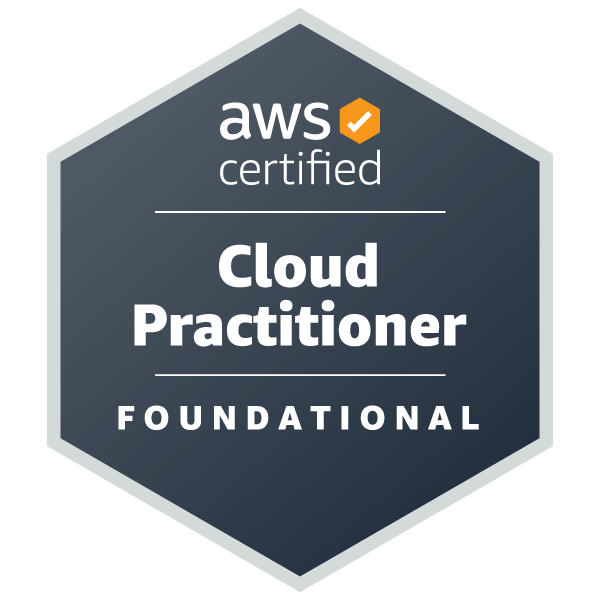

<!-- Header Banner -->

<!-- Typing Animation -->

  
  
  

---

### 👩‍💻 About Me

State Engineer in Software Engineering (**ENSA Khouribga, 2026 – Highest Honors / *Mention Très Bien***), based in **Casablanca, Morocco** 🇲🇦. I specialize in **Backend & AI Engineering** (Python, Java Spring Boot, Machine Learning) and **Cloud / DevOps Industrialization** (AWS, Docker, Kubernetes/EKS, Terraform, CI/CD).

- 💼 **Recent Experience:**
  - **BSS Integrator & Application Deployment (PFE)** @ *Inetum Offshore Maroc (Telecom Client)* — Comarch BSS (CPML) business rules, real-time API observability with **Grafana**, and **CI/CD** release automation in an international Agile/Scrum team.
  - **Python Backend Developer (PFA)** @ *Capgemini Engineering* — Python automation tooling and deliverable validation pipelines.
- 🎓 **Education:** State Engineering Degree in Software Engineering, ENSA Khouribga (2021–2026).
- 🏅 **Certifications:** **AWS Certified Cloud Practitioner (CLF-C02)** & **ALX Professional Foundations**.
- 📫 **Reach me at:** [ikrame.gouaiche.ig@gmail.com](mailto:ikrame.gouaiche.ig@gmail.com)

---

### 🛠️ Tech Stack

**Backend, AI & Frontend**
 

  

**Cloud, DevOps & Observability**
 

📋 Full Skills Breakdown

- **Languages & Frameworks:** Python, Java (Spring Boot), TypeScript, JavaScript, Node.js, Express, React.js, Angular, Redux Toolkit, Tailwind CSS
- **AI & Data:** Machine Learning (Matching & Recommendation), PostgreSQL, MySQL, MongoDB, REST APIs, Socket.IO
- **Cloud (AWS):** EKS, EC2, S3, ECR, VPC, IAM, RDS, CloudWatch
- **DevOps & Observability:** Docker, Kubernetes, Helm, Terraform (IaC), GitHub Actions, GitLab CI, Jenkins, SonarQube, Grafana, Linux/Unix, Bash, Jira (Scrum)

---

### 🚀 Featured Projects

<table>
  <tr>
    <td width="50%" valign="top">
      <h4>🤖 <a href="https://github.com/Ikrame-Gouaiche/LanceJob_Platforme_Freelance">LanceJob — AI Freelance Matching</a></h4>
      
Full-stack freelance marketplace integrating a <b>Machine Learning</b> matching & recommendation engine, JWT authentication, real-time messaging (Socket.IO), and Stripe/PayPal payments.

      
<code>Python ML</code> • <code>Node.js</code> • <code>React</code> • <code>MongoDB</code>

    </td>
    <td width="50%" valign="top">
      <h4>☸️ <a href="https://github.com/Ikrame-Gouaiche/microservices-k8s-Helm">Microservices on Kubernetes & Helm</a></h4>
      
Polyglot 6-microservice e-commerce architecture behind a Netflix Zuul API Gateway, containerized with Docker and orchestrated on <b>Kubernetes</b> using <b>Helm Charts</b> (ChartMuseum) & HPA.

      
<code>Spring Boot</code> • <code>Python</code> • <code>Docker</code> • <code>K8s</code> • <code>Helm</code>

    </td>
  </tr>
  <tr>
    <td width="50%" valign="top">
      <h4>☁️ <a href="https://github.com/Ikrame-Gouaiche/AWS_Solution_Architect_Labs">AWS Solutions Architect Labs</a></h4>
      
Hands-on cloud infrastructure labs covering AWS networking (VPC), IAM security, compute, storage, and scalable architecture patterns.

      
<code>AWS</code> • <code>VPC</code> • <code>IAM</code> • <code>Cloud Architecture</code>

    </td>
    <td width="50%" valign="top">
      <h4>🏥 <a href="https://github.com/Ikrame-Gouaiche/CabineXFontOffice">CabinetX FrontOffice</a></h4>
      
Modern TypeScript frontend application for medical practice and appointment management.

      
<code>TypeScript</code> • <code>Frontend</code> • <code>Web App</code>

    </td>
  </tr>
</table>

---

### 🏆 Certifications & GitHub Activity

  <table>
    <tr>
      <td align="center" valign="middle">
        
         
        <b>AWS Cloud Practitioner (CLF-C02)</b>
      </td>
      <td align="center" valign="middle">
        
      </td>
    </tr>
  </table>

